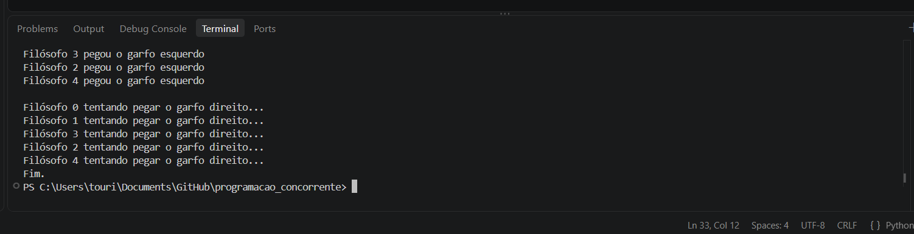
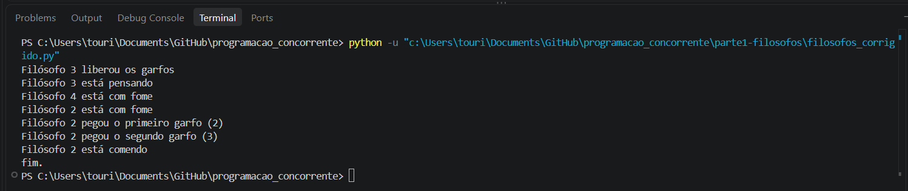
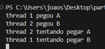
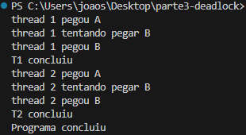

## *GRUPO 2*

## *INTEGRANTES:*
- Anna Beatriz Gamba Müller
- Guilherme dos Santos Marciano Barbosa
- João Victor Squizati Miyashita
- Leticia Figueiredo Dias

## *LINGUAGEM ESCOLHIDA:*
- Python

## *PARTE 1 - JANTAR DOS FILÓSOFOS:*

**Print 1: deadlock.** Os cinco filósofos seguram o garfo esquerdo e nenhum consegue o direito.



**Print 2: execução sem interrupção.** Com a ordenação dos garfos, os filósofos comem repetidamente até o fim, sem travar.




### Como executar

```bash
python parte1-filosofos/filosofos_ingenuo.py
python parte1-filosofos/filosofos_corrigido.py
```
## Perguntas e respostas: Jantar dos Filósofos

### 1. O que é o problema do Jantar dos Filósofos?
É um problema clássico de concorrência: cinco filósofos alternam entre pensar e comer, e o desafio é fazer todos comerem sem o programa travar

### 2. Como funciona a dinâmica dos cinco filósofos e dos cinco garfos?
Há um garfo entre cada par de filósofos e para comer, o filósofo precisa dos dois garfos ao lado dele. Depois de comer, devolve os garfos. No código, cada filósofo é uma thread e cada garfo é um Lock

### 3. O que é deadlock?
É quando as threads ficam esperando umas pelas outras para sempre, e o programa trava

### 4. Por que o protocolo ingênuo pode causar deadlock?
Porque todos pegam primeiro o garfo esquerdo e se os cinco pegarem ao mesmo tempo, cada um espera o garfo do vizinho, e ninguém consegue comer

### 5. Quais são as quatro condições de Coffman?
1. **Exclusão mútua:** um garfo só pode ser usado por um filósofo por vez.
2. **Posse e espera:** o filósofo segura um garfo enquanto espera o outro
3. **Sem preempção:** ninguém tira o garfo de quem está com ele
4. **Espera circular:** os filósofos formam um ciclo, cada um esperando o garfo do próximo

### 6. Qual estratégia foi utilizada para evitar o deadlock?
Ordenação de recursos: os garfos são numerados e todo filósofo pega primeiro o garfo de menor número

### 7. Qual condição de coffman foi eliminada pela estratégia escolhida?
a **espera circular**. Com todos seguindo a mesma ordem, o ciclo não consegue se formar

### 8. Como a solução garante que todos os filósofos tenham oportunidade de comer, evitando inanição?
A ordenação evita o deadlock, então sempre alguém consegue comer e o programa não para. Ela não garante formalmente que nenhum filósofo fique sem comer, mas na prática isso é raro, porque os garfos são liberados rapidamente e o tempo de pensar é aleatório. Nas nossas execuções, todos comeram várias vezes


## *PARTE 2 - SEMÁFORO:*
**Versão 1:**
- Sem sincronização das tarefas e com perda significativa de incrementos

| *V. Esprado*   |   *V. Obtido*    |         *Tempo*         |
|----------------|------------------|-------------------------|
|  1.600.000     |    1.444.251     |  -0.13269639015197754   |
|  1.600.000     |    1.256.579     |  -0.14069247245788574   |
|  1.600.000     |    1.397.520     |  -0.1107630729675293    |


→ Essa perda de incrementos ocorre porque como algumas tarefas acabamo rodando ao mesmo tempo, o computador não consegue calcular adequadamente essa quantidade de incrementos. Pois como não tem essa sincronização, uma tarefa atropela a outra, fazendo com que o computador ache que só foi uma tarefa ao inves de 2 ou mais, o que acaba gerando essa descrepancia entre o valor esperado e o obtido.

## *PARTE 3 - DEADLOCK:*

O deadlock é a situação em que as threads ficam travadas, porque cada uma está segurando um recurso de que a outra precisa. Ele surge quando as quatro condições de Coffman acontecem juntas: exclusão mútua, espera circular, manter e esperar, e não preempção. A versão travada usa dois locks, cada um com um único dono por vez, e duas funções que fazem o papel das threads. Quando uma thread pega o lock de um recurso, as outras ficam impedidas de usar. Assim, a Thread 1 fica com o lock A e aguarda o B, que está com a Thread 2. A Thread 2, por sua vez, fica com o lock B e aguarda o A, que está com a Thread 1, formando uma espera circular. Como nenhum recurso é tirado à força de quem o está usando, as duas ficam paradas para sempre e acontece o deadlock.



Na versão corrigida, o problema foi resolvido com a hierarquia de recursos, que elimina a espera circular. A ideia é que as duas threads sempre comecem pelo mesmo recurso, ou seja, peguem o lock A antes do lock B. Com isso, a thread que não consegue o lock A fica esperando sem ter nenhum lock, e a outra consegue concluir o trabalho e soltar os dois.



Como executar:
```bash
python parte3-deadlock/deadlock_travado.py
python parte3-deadlock/deadlock_corrigido.py
```
A versão travada não termina, para parar é só fechar o terminal.

## *LINK DO VÍDEO:*
