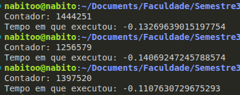

## *SEMÁFORO:*
**Versão 1:**
- Sem sincronização das tarefas e com perda significativa de incrementos

| *V. Esprado*   |   *V. Obtido*    |         *Tempo*         |
|----------------|------------------|-------------------------|
|  1.600.000     |    1.444.251     |  -0.13269639015197754   |
|  1.600.000     |    1.256.579     |  -0.14069247245788574   |
|  1.600.000     |    1.397.520     |  -0.1107630729675293    |

→ Essa perda de incrementos ocorre porque como algumas tarefas acabamo rodando ao mesmo tempo, o computador não consegue calcular adequadamente essa quantidade de incrementos. Pois como não tem essa sincronização, uma tarefa atropela a outra, fazendo com que o computador ache que só foi uma tarefa ao inves de 2 ou mais, o que acaba gerando essa descrepancia entre o valor esperado e o obtido.